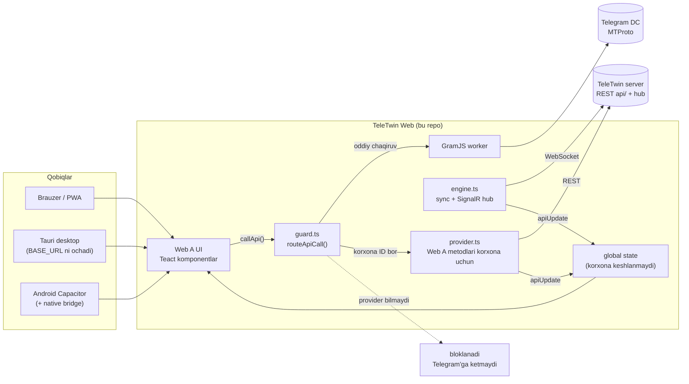
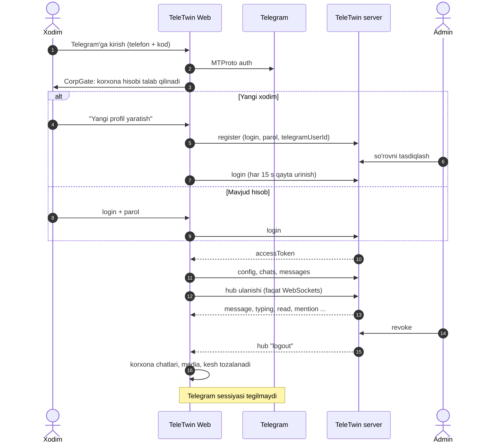
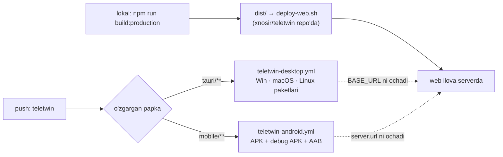

<p align="center">
  
</p>

<h1 align="center">TeleTwin Web</h1>

<p align="center"><b>Bitta ilova, ikki dunyo:</b> shaxsiy chatlar Telegram'da, korxona chatlari korxonaning o'z serverida.</p>

<p align="center">
  
  
  
  
  
  <a href="LICENSE"></a>
  
  <a href="https://github.com/users/xnosir/projects/4"></a>
</p>

> [!NOTE]
> TeleTwin Web — [Telegram Web A](https://github.com/Ajaxy/telegram-tt) (`Ajaxy/telegram-tt`, GPL-3.0) asosidagi fork.
> Bu **rasmiy Telegram ilovasi emas** va Telegram bilan bog'liq emas. Asl loyiha README'si va bog'liqliklar litsenziyalari:
> [`docs/UPSTREAM-README.md`](docs/UPSTREAM-README.md).

---

## 🧭 Bu nima?

TeleTwin — xodim uchun bitta messenjer: Telegram akkaunti odatdagidek ishlaydi (oila, do'stlar, kanallar),
yonida esa **"Korxona"** papkasi paydo bo'ladi — u chatlar, kanallar va xabarlar Telegram'ga umuman yetib bormaydi,
faqat korxonaning TeleTwin serverida yashaydi. Admin xodimni o'chirsa, korxona qismi darhol yo'qoladi, shaxsiy Telegram qoladi.

Bu repo — ekotizimning **web klienti** va undan qurilgan **desktop (Tauri)** hamda **Android (Capacitor)** qobiqlari.
Server (backend), admin panel, Telegram Desktop fork va umumiy hujjatlar — asosiy repo'da:
**[xnosir/teletwin](https://github.com/xnosir/teletwin)**.

## 🏠 Home va Overview

| Sahifa | Havola |
|---|---|
| 🏠 **Home** — mahsulot sahifasi va yuklab olish | <https://tele.dtwin.uz/> |
| 🎬 **Overview** — bir daqiqalik jonli tanishuv | [uz](https://tele.dtwin.uz/overview/) · [ru](https://tele.dtwin.uz/overview/ru/) · [en](https://tele.dtwin.uz/overview/en/) |
| 💬 **Ilova** — Telegram + korxona (Web) · PWA | <https://tele.dtwin.uz/web/> · <https://tele.dtwin.uz/app/> |

## ✨ Imkoniyatlar

Belgilar: ✅ kod bor va ishlatilmoqda · 🟡 kod bor, to'liq sinalmagan · 🔜 rejada

| Imkoniyat | Holat | Qayerda |
|---|---|---|
| Telegram akkaunti bilan to'liq Web A (shaxsiy chatlar, kanallar, media) | ✅ | upstream |
| "Korxona" lokal papkasi: korxona guruhlari, kanallari, shaxsiy (DM) chatlar | ✅ | `src/teletwin/state.ts`, `ids.ts` |
| Majburiy korxona kirishi (CorpGate): login yoki ro'yxatdan o'tish → admin tasdig'i | ✅ | `components/CorpGate.tsx`, `index.ts` |
| Xabar: yuborish, javob (reply), tahrir, o'chirish, ✓✓ o'qildi, typing, pin | ✅ | `provider.ts`, `engine.ts` |
| Reaksiya, forward (faqat korxona chatlari ichida) | 🟡 | `provider.ts` |
| Media: rasm, ovozli xabar, video, fayl (korxona serveridan, keshsiz) | 🟡 rasm/ovoz sinalgan, hujjat/round/sticker to'liq emas | `media.ts` |
| Mention (`@all`, `@here`), @ hisoblagich, ovozli "uyg'otish" (wake-up) | ✅ | `wakeup.ts`, `CorpWakeUp.tsx` |
| So'rovnoma (poll), rejalashtirilgan xabar, thread (guruh va kanal) | 🟡 | `provider.ts`, `CorpThread.tsx` |
| Jira kartochkasi (havola ustida hover / uzoq bosish), guruh mention | 🟡 | `CorpJiraCard.tsx` |
| Holat va DND ("Holatim"), xodim profili ("Profilim") | 🟡 | `status.ts`, `CorpStatus.tsx`, `CorpProfile.tsx` |
| Saqlangan xabarlar + eslatma, "Faollik" lentasi, "Kanallar katalogi" | 🟡 | `saved.ts`, `activity.ts`, `CorpDirectory.tsx` |
| Global qidiruvda korxona xabarlari | 🟡 | `src/global/actions/api/globalSearch.ts` |
| Revoke → korxona ma'lumoti darhol tozalanadi, offline keshda saqlanmaydi | ✅ | `src/global/cache.ts`, `engine.ts` |
| Desktop: Windows (NSIS), macOS (arm64/x64 DMG), Linux (deb, AppImage) | ✅ CI build · 🟡 imzosiz, auto-update yo'q | `tauri/`, `teletwin-desktop.yml` |
| Android APK (tester kaliti bilan imzolangan), bildirishnoma va yuklab olish bridge | ✅ CI build | `mobile/`, `teletwin-android.yml` |
| iOS ilova | 🔜 | — |
| Korxona ichida audio/video qo'ng'iroq | 🔜 (dizayn asosiy repo'da) | — |

## 🏗 Arxitektura

Asosiy g'oya: Web A'dagi **har bir** Telegram API chaqiruvi `callApi` orqali o'tadi. TeleTwin shu nuqtaga router qo'yadi:
argumentlarida korxona ID'si bor chaqiruv GramJS worker'ga (ya'ni Telegram'ga) **hech qachon** yetmaydi —
u korxona provider'iga yo'naltiriladi yoki bloklanadi. Korxona ID'lari alohida diapazonda (`[2^48 − 2^32, 2^48)`),
Telegram ID'lari bilan to'qnashmaydi.



### Kirish va revoke oqimi



### Upstream'ga qanday tegilgan

Bizning o'zgarishlar ikki qatlam: yangi kod `src/teletwin/` da (~6 500 qator), Web A ichida esa faqat
nuqtaviy "ilgaklar" (har birida `TeleTwin:` izohi). Asosiylari:

| Fayl | Nima |
|---|---|
| `src/api/gramjs/worker/connector.ts` | `callApi` / `callApiLocal` → `routeApiCall()` router |
| `src/global/cache.ts` | korxona ma'lumoti keshga yozilmaydi (revoke offline'da ham ishlashi uchun) |
| `src/components/main/Main.tsx`, `src/index.tsx` | `CorpRoot` va `initTeleTwin()` |
| `src/hooks/useFolderTabs.ts` | "Korxona" papkasini tahrirlab/ulashib bo'lmaydi |
| `src/components/middle/message/*ContextMenu*` | korxona chatida ishlamaydigan menyu bandlari yashiriladi |
| `src/config.ts`, `index.html`, `public/`, `tauri/icons/` | TeleTwin nomi va ikonkalar |
| `vite.config.ts` | CSP `connect-src` ga TeleTwin server qo'shilgan |

## 🧱 Stek

| Qatlam | Texnologiya |
|---|---|
| UI | Telegram Web A: TypeScript, [Teact](https://github.com/Ajaxy/teact), SCSS, Vite |
| Telegram protokoli | GramJS (MTProto, Web Worker) — upstream |
| Korxona realtime | `@microsoft/signalr` (WebSockets, `skipNegotiation`) |
| Korxona API | `fetch` REST klient (`src/teletwin/api.ts`) |
| Desktop | Tauri 2 (Rust) — `tauri/tauri.teletwin.conf.json` |
| Android | Capacitor 8, Java (`TeleTwinBridge`: bildirishnoma, yuklab olish) |
| CI | GitHub Actions: `teletwin-desktop.yml`, `teletwin-android.yml` |
| Node | `.node-version` = 26 |

## 📁 Tuzilma

```text
teletwin-web/
├── src/
│   ├── teletwin/              # ⭐ TeleTwin korxona qatlami (hammasi shu yerda)
│   │   ├── guard.ts           #   Telegram API router: korxona ID -> provider yoki blok
│   │   ├── provider.ts        #   Web A metodlarining korxona varianti (fetchMessages, sendMessage, ...)
│   │   ├── engine.ts          #   sessiya, sinxronlash, SignalR hub hodisalari
│   │   ├── api.ts             #   TeleTwin server REST klienti
│   │   ├── ids.ts             #   korxona ID diapazoni, "Korxona" papka ID
│   │   ├── state.ts           #   korxona chat/xabarlarini Web A state'iga aylantirish
│   │   ├── media.ts           #   korxona media (keshsiz, blob URL)
│   │   ├── storage.ts         #   localStorage: Telegram akkaunti bo'yicha korxona hisobi
│   │   ├── wakeup.ts  saved.ts  activity.ts  status.ts  profile.ts
│   │   └── components/        #   CorpGate, CorpJiraCard, CorpStatus, CorpSaved, CorpDirectory, ...
│   ├── api/gramjs/worker/connector.ts   # router ilgagi
│   └── ...                    # qolgani — upstream Web A
├── tauri/                     # desktop qobiq (upstream + tauri.teletwin.conf.json)
├── mobile/                    # Android Capacitor qobiq (uz.dtwin.teletwin)
│   ├── capacitor.config.json  #   ochiladigan web manzil
│   └── android/               #   Gradle loyiha, TeleTwinBridge.java, teletwin_bridge.js
├── .github/workflows/         # teletwin-desktop.yml, teletwin-android.yml (+ upstream package-and-publish.yml)
├── docs/UPSTREAM-README.md    # asl Telegram Web A README'si
└── LICENSE                    # GPL-3.0
```

## 🚀 Tez boshlash

Kerak: Node 26 (`.node-version`), npm. Telegram `api_id` / `api_hash` — o'zingizniki, [my.telegram.org](https://my.telegram.org) dan.

```sh
cp .env.example .env          # TELEGRAM_API_ID, TELEGRAM_API_HASH ni to'ldiring
npm i
npm run dev                   # http://localhost:1234
```

Production build (statik fayllar `dist/` ga):

```sh
BASE_URL=https://example.com/web/ npm run build:production
npm run check                 # tsc + eslint + stylelint
npm test                      # vitest (upstream testlari)
```

Desktop paket (Rust toolchain kerak; CI'dagi bilan bir xil konfiguratsiya):

```sh
npm ci
npx tauri build -c tauri/tauri.teletwin.conf.json --bundles nsis      # Windows
# macOS: --bundles dmg   ·   Linux: --bundles deb,appimage
```

Android APK (JDK 21, Android SDK):

```sh
cd mobile
npm ci
npx cap sync android
cd android && ./gradlew assembleDebug
```

> [!TIP]
> Korxona qismini sinash uchun TeleTwin server kerak — uni ishga tushirish [xnosir/teletwin](https://github.com/xnosir/teletwin) da.
> Login oynasidagi **"Server"** maydoniga server manzilini kiritasiz.

## ⚙️ Sozlash

**`.env` (build vaqtida)** — fayl git'ga tushmaydi, qiymatlar hech qachon commit qilinmaydi.

| Kalit | Vazifasi |
|---|---|
| `TELEGRAM_API_ID` | Telegram ilova ID (my.telegram.org) |
| `TELEGRAM_API_HASH` | Telegram ilova hash |
| `BASE_URL` | ilova joylashadigan ommaviy manzil (canonical URL, manifest) |
| `APP_TITLE` | ixtiyoriy: oyna sarlavhasi (default `TeleTwin`) |
| `APP_ENV` | `development` / `staging` / `production` (npm skriptlar o'zi qo'yadi) |

**Ilova ichida**

| Joy | Nima |
|---|---|
| `src/teletwin/api.ts` → `DEFAULT_CORP_SERVER` | korxona serverining default manzili; foydalanuvchi login oynasida o'zgartira oladi |
| `tauri/tauri.teletwin.conf.json` → `frontendDist` | desktop qobiq ochadigan web manzil |
| `mobile/capacitor.config.json` → `server.url` | Android qobiq ochadigan web manzil |
| `vite.config.ts` → CSP `connect-src` | boshqa serverga ko'chilsa shu yerga ham qo'shiladi |

**CI secret'lari (Android)** — faqat nomlari; keystore repo'ga hech qachon tushmaydi.

| Secret | Vazifasi |
|---|---|
| `TELETWIN_TESTER_KEYSTORE_BASE64`, `TELETWIN_TESTER_KEYSTORE_PASSWORD` | tester APK uchun barqaror imzo (yangi build eskisining ustiga o'rnatiladi) |
| `TELETWIN_KEYSTORE_BASE64`, `TELETWIN_KEYSTORE_PASSWORD`, `TELETWIN_KEY_ALIAS`, `TELETWIN_KEY_PASSWORD` | release AAB imzosi (bo'lmasa AAB imzosiz qoladi) |

## 🚢 Deploy



- **Web** — `dist/` lokal build qilinadi va asosiy repo'dagi `deploy/deploy-web.sh` bilan serverga yuklanadi
  (`*.map` va build statistikasi yuklanmaydi). Hozirgi ommaviy manzil: `https://dtwin.uz/teletwin/web/`.
- **Desktop va Android** qobiqlari web ilovani serverdan ochadi — shuning uchun **web deploy har bir o'rnatilgan
  desktop va telefonni avtomatik yangilaydi**, yangi paket faqat qobiq o'zgarganda kerak.
- Paketlar GitHub Actions artefakti sifatida chiqadi (Release sahifasi hali yo'q). Desktop paketlari kod-imzosiz.
- Upstream'dan qolgan `package-and-publish.yml` faqat `master` push yoki qo'lda ishga tushadi — TeleTwin uchun ishlatilmaydi.

## 📜 Tarix

Fork **orphan import** sifatida boshlangan: upstream tarixi olib kelinmagan, birinchi commit
`276ffe9` = `Ajaxy/telegram-tt @ 6002824`. Undan keyingi hamma commit — TeleTwin.

| Sana | Bosqich | Natija |
|---|---|---|
| 2026-10-29 | `276ffe9` Upstream import | Telegram Web A `6002824` (GPL-3.0) asos qilib olindi |
| 2026-10-29 | `b1ef911`…`04ecee1` Korxona qatlami MVP | "Korxona" papkasi, API guard, menyu, CSP, TeleTwin brendi |
| 2026-10-29 | `1262325`…`acf5e4b` Desktop CI | Tauri paketlari Win/macOS/Linux uchun yashil |
| 2026-10-29 | PR [#1](https://github.com/xnosir/teletwin-web/pull/1) Android | Capacitor qobiq, native bridge, tester APK imzosi |
| 2026-10-29 | `7b71d0d`…`38132ed` Provider + Gate | korxona chatlari bloklanmaydi, provider orqali ishlaydi; majburiy kirish; DM; wake-up |
| 2026-10-29 | `3a14c86`…`4bd9dc0` Stage A UI | mention, poll, rejalashtirilgan xabar, thread |
| 2026-10-29 → 30 | `bfc3b10`…`a1af5fd` Stage B UI | Jira kartochka, guruh mention, mute, holat/DND, global qidiruv |
| 2026-10-30 | `caafd44`…`a8061b8` Ish joyi | ovozli xabar fix, saqlanganlar + eslatma, Faollik, Profilim, Kanallar katalogi, kanal thread |

PR [#2](https://github.com/xnosir/teletwin-web/pull/2) (Android klaviatura) — foydasi o'lchanmagani uchun yopilgan.

## 🗺 Yo'l xaritasi

To'liq reja va holat: **[GitHub Project #4](https://github.com/users/xnosir/projects/4)**.

- 🧪 Sifat: `src/teletwin/` uchun unit testlar (guard, ids), web uchun PR CI (tsc + eslint + vitest)
- 🧩 Korxona funksiyalarini to'liq tasdiqlash: forward, hujjat, round video, sticker, ro'yxatdan o'tish oqimi
- 🌐 TeleTwin matnlari hozir faqat o'zbekcha — rus va ingliz tarjimasi
- 📦 Desktop kod-imzosi va auto-update, Android release (Play) imzosi, GitHub Release
- 📱 iOS qobig'i
- 📞 Korxona ichida qo'ng'iroqlar (dizayn: asosiy repo)
- 🔄 Upstream Web A yangilanishlarini olish tartibi (orphan import sababli qo'lda)

## 🤝 Hissa / ish tartibi

- Default branch: **`teletwin`**. Har o'zgarish alohida branch → PR → `teletwin`.
- Korxona kodi `src/teletwin/` da. Web A fayliga tegish kerak bo'lsa — minimal ilgak va `// TeleTwin: ...` izohi,
  shunda upstream bilan solishtirish oson.
- Commit sarlavhasi upstream uslubida, inglizcha: `TeleTwin / Corp: ...`, `TeleTwin / Android: ...`, `[CI] Tauri: ...`.
- **Repo PUBLIC:** `.env`, `api_id`/`api_hash`, keystore, token, server ichki tafsilotlari commit qilinmaydi.
- Kod uslubi va tekshiruvlar upstream'niki: `npm run check`, [`AGENTS.md`](AGENTS.md).

## 📄 Litsenziya

[GPL-3.0](LICENSE) — upstream [Telegram Web A](https://github.com/Ajaxy/telegram-tt) bilan bir xil. Bu fork'ning
butun manba kodi shu repo'da ochiq. Bog'liqliklar va ularning litsenziyalari ro'yxati:
[`docs/UPSTREAM-README.md`](docs/UPSTREAM-README.md#dependencies).

Telegram nomi va logotipi Telegram'ga tegishli; TeleTwin — mustaqil, norasmiy klient.
